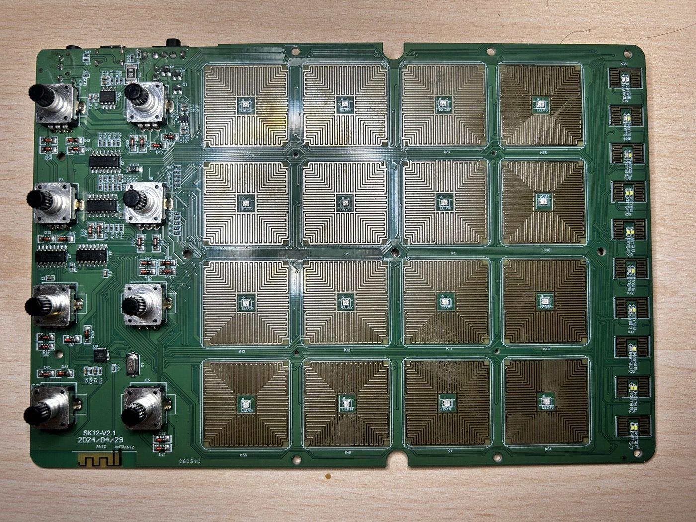
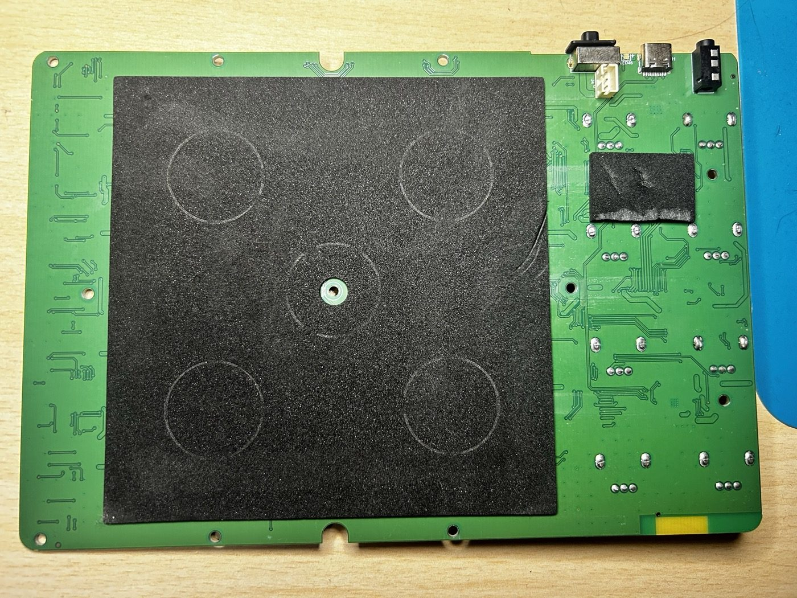
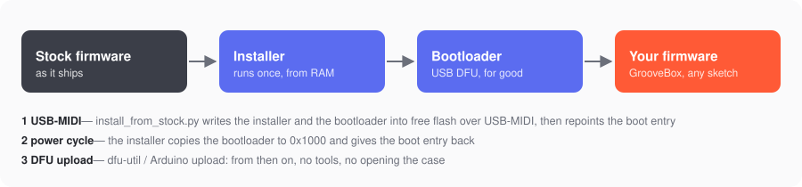
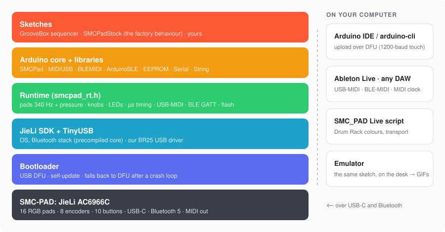
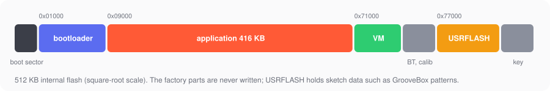

<h1 align="center">open-smc-pad</h1>

<p align="center"><b>Open firmware for the M-Vave SMC-PAD</b><br>
a bootloader, an Arduino core and a step sequencer for a 16-pad MIDI controller</p>

<p align="center"></p>

<p align="center">
<a href="LICENSE"></a>


</p>

The [M-Vave SMC-PAD](https://www.m-vave.com) is an inexpensive pad controller: 16 RGB
velocity- and pressure-sensitive pads, 8 endless knobs, 10 buttons, USB-C, Bluetooth MIDI and a
battery. Inside is a JieLi AC6966C, a Bluetooth audio chip that nobody writes firmware for.

This project replaces its firmware, completely and reversibly, with one you can read and change:

- 🎛️ **[GrooveBox](https://github.com/fedepaj/groovebox)** — a 16-track step sequencer in the
  spirit of the Digitakt and the BeatStep Pro: probability, conditions, ratchets, parameter
  locks, live recording, euclidean patterns, pattern chains, MIDI clock in and out, and an
  Ableton Live script that paints the pads with your Drum Rack.
- 🧩 **[An Arduino core](arduino)** — write your own firmware as
  an Arduino sketch: libraries for the pads, knobs and LEDs, USB-MIDI, BLE-MIDI, ArduinoBLE,
  EEPROM; upload from the Arduino IDE.
- 🎹 **The controller it was** — [SMCPadStock](arduino/sketches/SMCPadStock)
  does what the factory firmware did (notes, CCs, Mackie Control, note repeat, aftertouch), as a
  sketch you can tweak.
- 🔌 **[A USB bootloader](fw)** — installed from the stock
  firmware over USB, no tools inside the case; firmware updates by DFU from then on, and it
  catches a crashing firmware so the pad can never be lost to a bad upload.

<table>
<tr>
<td></td>
<td></td>
</tr>
<tr><td align="center"><sub>The board (SK12-V2.1): pad sensors with their RGB LEDs, the 8 encoders, two 74HC595 for the keys</sub></td>
<td align="center"><sub>The back: power switch, USB-C and the 3.5 mm MIDI out, top right</sub></td></tr>
</table>

## Install

<p align="center"></p>

On a pad with the factory firmware, with a USB cable, from macOS or Linux:

```sh
git clone --recursive https://github.com/fedepaj/open-smc-pad && cd open-smc-pad
uv run --with mido --with python-rtmidi host/install_from_stock.py
```

The script talks to the stock firmware over USB-MIDI (the same channel the M-Vave app uses),
writes a small installer and the bootloader into free flash, and asks you to switch the pad off
and on once. The installer then puts the bootloader in place of the factory firmware and the
script uploads a first firmware. Every byte is read back before anything is switched over; if
something does not check out, the stock firmware simply boots again.

Afterwards any firmware goes on over USB: from the Arduino IDE, or `dfu-util -d 1209:0002 -a 0 -D
firmware.bin` with the pad in its bootloader (hold **SHIFT + PLAY** while switching it on).

### The Arduino core

In the Arduino IDE, *Settings → Additional boards manager URLs*:

```
https://github.com/fedepaj/open-smc-pad/releases/latest/download/package_smcpad_index.json
```

then install **SMC-PAD (open firmware)** from the Boards Manager (macOS and Linux for now; it
fetches the JieLi compiler from JieLi). More in [arduino/README.md](arduino/README.md#install).

> **Status:** works end to end on the author's pad. The first release will ship the ready-made
> install package (until then `install_from_stock.py` needs the files from a source build, see
> [fw/README.md](fw/README.md#building)). To go back to the
> factory firmware you need the recovery path below — keep that in mind.

**Recovery.** The bootloader goes to DFU by itself after a firmware crashes four times at start,
and it updates itself through a staging area, so a cut power never leaves the pad without one.
The last resort, the chip's ROM download mode, needs a Raspberry Pi Pico on the USB data lines
([`hw/jl-usbkey`](hw/jl-usbkey), [docs/flash-layout.md](docs/flash-layout.md)) — it is also how the
factory firmware can be written back.

## How it fits together

<p align="center"></p>

<p align="center"></p>

| | |
|---|---|
| [`fw/`](fw) | the bootloader, the runtime and drivers under the Arduino core |
| [`arduino/`](arduino) | the Arduino core (Boards Manager package built by CI), libraries, SMCPadStock, the self-test, the emulator |
| [`host/`](host) | install from stock, DFU, flashing in ROM mode, MIDI monitor, the core's self-test runner |
| [`docs/`](docs) | everything learned about the pad, and the decisions |
| [`hw/jl-usbkey`](hw/jl-usbkey) | the Raspberry Pi Pico recovery sketch (ROM download mode) |
| [`re/`](re) | reverse engineering scripts and captures |
| [**groovebox**](https://github.com/fedepaj/groovebox) | **its own repository**: the sequencer, its guide and the Ableton Live script |

Clone with `--recursive`: the JieLi SDK, TinyUSB, ArduinoCore-API and the JieLi tools by
kagaimiq come in as submodules.

## Documentation

| | |
|---|---|
| [hardware.md](docs/hardware.md) | every pin: pads (4051 muxes into the ADC), key matrix (595s), button LED multiplex, RGB chain, power; calibration |
| [bootloader.md](docs/bootloader.md) | the bootloader, DFU, self-update, crash recovery, installing from stock, pitfalls |
| [flash-layout.md](docs/flash-layout.md) | the flash, JLFS directories, the SFC encryption, boot selection, ROM download mode |
| [usb-br25.md](docs/usb-br25.md) | the BR25 USB controller as our TinyUSB driver uses it |
| [sinco-protocol.md](docs/sinco-protocol.md) | the stock firmware's SysEx protocol (what the M-Vave app speaks) |
| [bluetooth.md](docs/bluetooth.md) | BLE-MIDI, the GATT runtime, why the address depends on the services |
| [stock-behaviour.md](docs/stock-behaviour.md) | what the factory firmware does, from its manual and its presets |
| [gaps.md](docs/gaps.md) | what is not known or not done yet |

Decisions and the reasons behind them live next to the code they concern: in comments, and in
these documents' "why" and "pitfalls" sections.

## Status

Working: bootloader (install from stock, DFU, self-update, crash recovery), all the controls
(pads with velocity and pressure, knobs, buttons, all LEDs), USB-MIDI, USB serial, BLE-MIDI and
custom BLE services, the Arduino core (71 self-tests on the device), GrooveBox, SMCPadStock, the
Ableton script.

Not yet: the 3.5 mm MIDI OUT, a Boards Manager package, release binaries, Windows hosts, a
browser editor. See [gaps.md](docs/gaps.md).

## Credits

- [kagaimiq](https://github.com/kagaimiq) — jl-uboot-tool, jielie, ghidra-jieli and the
  documentation that made the JieLi chips approachable.
- [JieLi](https://github.com/Jieli-Tech) — the AC63 SDK (Apache 2.0).
- [TinyUSB](https://github.com/hathach/tinyusb), [ArduinoCore-API](https://github.com/arduino/ArduinoCore-API),
  [blink](https://github.com/jart/blink).

Not affiliated with M-Vave or JieLi. "SMC-PAD" and "M-Vave" are names of their owners, used here
to say what this firmware runs on. Opening your pad and replacing its firmware is at your own
risk.

## License

MIT — [LICENSE](LICENSE). Parts derived from the JieLi SDK are Apache 2.0
([fw/NOTICE](fw/NOTICE)).
