# GrooveBox

**A 16-track MIDI step sequencer for the M-Vave SMC-PAD**, in the spirit of the Digitakt and
the BeatStep Pro: step and live recording, per-step velocity, micro-timing, probability and
conditions, ratchets, parameter locks, euclidean patterns, 16 patterns with chains, note
repeat that follows how hard you press, MIDI clock in and out, and an Ableton Live companion
that paints the pads with your Drum Rack.

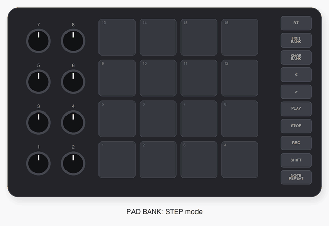

It runs on the SMC-PAD with the [open firmware](https://github.com/fedepaj/open-smc-pad) (our
bootloader plus the [Arduino core](https://github.com/fedepaj/open-smc-pad/tree/main/arduino)); it is an Arduino
sketch, so you can read it, change it and upload your own version.

Everything below — every animation included — comes from the real firmware: the pictures are
made by running this sketch in the [SMC-PAD emulator](https://github.com/fedepaj/open-smc-pad/tree/main/arduino/sim)
(`tools/make_images.py`).

---

- [Install](#install)
- [Your first beat](#your-first-beat)
- [The four modes](#the-four-modes)
- [PLAY mode](#play-mode) · [STEP mode](#step-mode) · [Live recording](#live-recording) ·
  [MUTE mode](#mute-mode) · [PATTERN mode](#pattern-mode)
- [Tempo and sync](#tempo-and-sync) · [Ableton Live](#ableton-live) · [Bluetooth](#bluetooth)
- [Reference: buttons](#buttons) · [knobs](#knobs) · [MIDI](#midi-implementation)
- [Building, the emulator, design notes](#building-and-hacking)

## Install

You need an SMC-PAD running the open firmware's bootloader — see
[open-smc-pad](https://github.com/fedepaj/open-smc-pad#install) (it installs from the stock
firmware over USB, no tools inside the case).

- **Ready-made:** download `GrooveBox.bin` from the [releases](https://github.com/fedepaj/groovebox/releases)
  and send it to the pad: `dfu-util -d 1209:0002 -a 0 -D GrooveBox.bin` (hold **SHIFT + PLAY**
  while switching the pad on to get the bootloader, or upload from a running firmware).
- **From the Arduino IDE / arduino-cli:** install the [SMC-PAD core](https://github.com/fedepaj/open-smc-pad/tree/main/arduino#install) (Boards Manager),
  open `GrooveBox/GrooveBox.ino`, board **M-Vave SMC-PAD (open firmware)**, Upload.

The pad shows up as a class-compliant USB-MIDI device ("SMC-PAD open fw") and, once Bluetooth
is on, as a BLE-MIDI one. Out of the box the 16 tracks play notes 36–51 on channel 10: a General
MIDI / Drum Rack kit.

## Your first beat

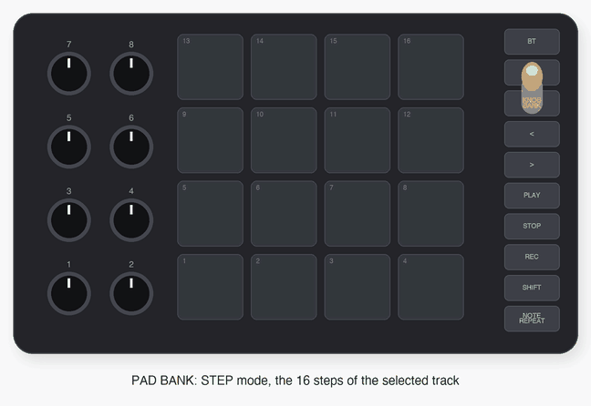

1. Press **PAD BANK**: STEP mode. The pads are now the 16 steps of the selected track (track 1,
   the kick). **Step 1 is top-left**, reading like a page.
2. Tap steps **1, 5, 9, 13**.
3. **SHIFT + pad 3** selects track 3 (the snare): tap steps **5** and **13**.
4. **PLAY**. The white light walking over the pads is the playhead. Tap a lit step to turn it off.
5. **PAD BANK** again: back to PLAY mode, where every pad is a track and flashes when it plays.

Your work is saved by itself (a few seconds after you stop, and at every pattern change).

 

## The four modes

The colours always tell where you are; the **PAD BANK** and **KNOB BANK** LEDs too.

| | |
|:---:|:---:|
| 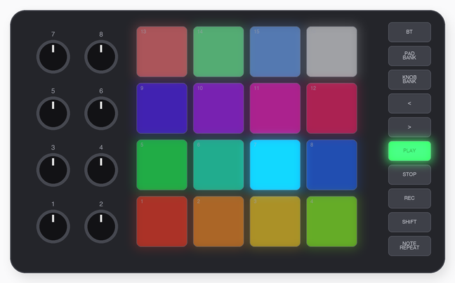 **PLAY** (default) — the pads are the 16 tracks | 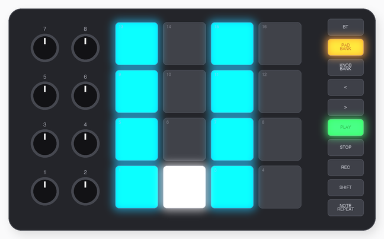 **STEP** — **PAD BANK** — the steps of the selected track |
| 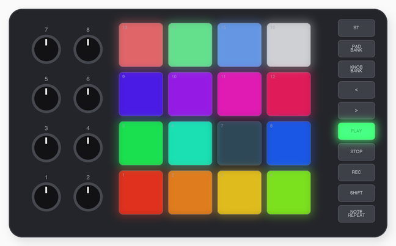 **MUTE** — **SHIFT + PAD BANK** — tap to mute a track | 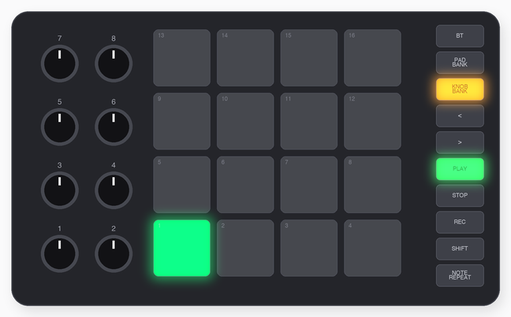 **PATTERN** — **SHIFT + KNOB BANK** — the 16 patterns |

Pressing the same combination again goes back to PLAY. Everywhere, **SHIFT + a pad** selects
that track (in PLAY mode, hitting a pad selects it too).

## PLAY mode

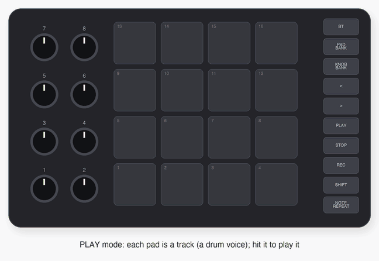

Each pad plays its track's note with the velocity of your hit. Holding a pad sends
**polyphonic aftertouch** from how hard you press.

**SHIFT + pads 9–16** (as on the stock firmware):

| pad | |
|---|---|
| 9 / 10 / 11 / 12 | velocity curve: linear / soft / hard / always full |
| 13 / 14 | transpose −1 / +1 semitone (what you play live) |
| 15 / 16 | octave −1 / +1 · **15 + 16 together**: back to normal |

 

### Note repeat

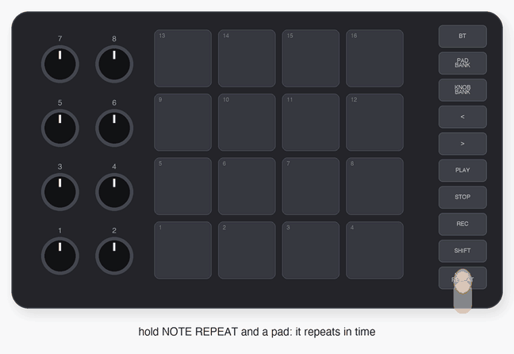

Hold **NOTE REPEAT** and a pad (in either order): the pad repeats in time with the sequencer.
**Press harder for louder repeats** — the velocity follows the pressure, MPC style. While
recording, the repeats are recorded too: instant hi-hat rolls.

- **NOTE REPEAT + knobs 1–4**: rate, swing, tempo, latch.
- **SHIFT + NOTE REPEAT**: the settings on the pads — pads **1–8** rate (1/4, 1/4T, 1/8, 1/8T,
  1/16, 1/16T, 1/32, 1/32T), **9–13** swing (off, 1–4), **14** latch, **15** sync to the
  incoming MIDI clock, **16** tap tempo (it blinks in time). **NOTE REPEAT** closes the page.
- With **latch** on, NOTE REPEAT toggles, and pads keep repeating after you let go; hit a pad
  again to stop it.

 

## STEP mode

Each pad is a step of the selected track; **< >** go through its pages (tracks can be up to
64 steps: four pages). Step 1 of a page is top-left. Dark steps are off; the faint ones mark
the beats.

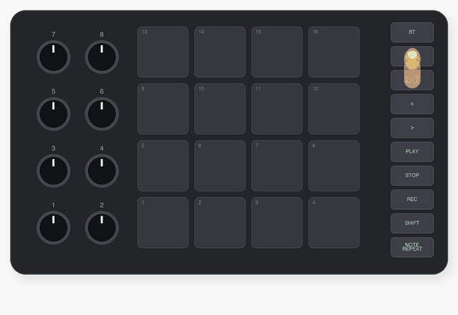

**Tap** an off step to turn it on (with the velocity of your tap), tap a lit one to turn it off.
**Hold** steps and turn knobs to edit them (several held steps change together):

| knob | with a step held |
|---|---|
| 1 | velocity |
| 2 | micro-timing: −11 … +11 / 24 of a step |
| 3 | how often it plays: probability 100 % … 1 %, then **1:2 2:2 1:3 2:3 3:3 1:4 2:4 3:4 4:4** (play on the n-th of every m loops), **FILL**, **NOT FILL** |
| 4 | ratchet: 1–4 hits inside the step |
| 5–8 | **parameter locks**: the value of the track's lock CCs (CC 70–73 by default) on this step only; turn left past 0 to remove |

While a knob turns, the pads show its value (a bar, or the choice among a few), then the steps
come back. Steps with a lock are lighter; steps with a condition pulse.

**FILL:** outside PLAY mode, holding **NOTE REPEAT** is the fill button: steps set to FILL play
only then, NOT FILL ones only otherwise.

 

### Euclidean patterns

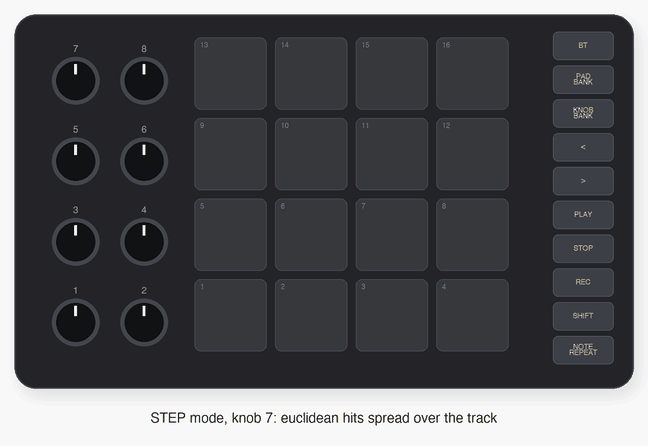

In STEP mode (no step held), **knob 7** spreads that many hits evenly over the track and
**knob 8** rotates them — the classic euclidean rhythms (3 in 8, 5 in 16 …). It rewrites the
track's steps.

 

## Live recording

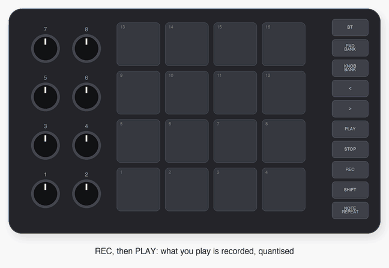

Press **REC** (it blinks), then **PLAY**, and play the pads in PLAY mode: each hit lands on the
nearest step of its track, **keeping how early or late you were** as micro-timing. Turning knobs
1–4 of page B records parameter locks on the step that is playing (if it is on). **REC** again stops recording.

**SHIFT + REC** (hold 1 s) clears the selected track.

 

## MUTE mode

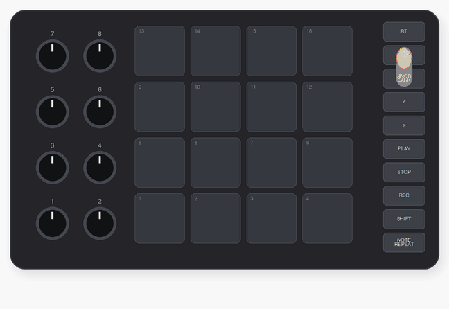

**SHIFT + PAD BANK.** One pad per track: tap to mute, tap again to bring it back. Playing tracks
flash.

 

## PATTERN mode

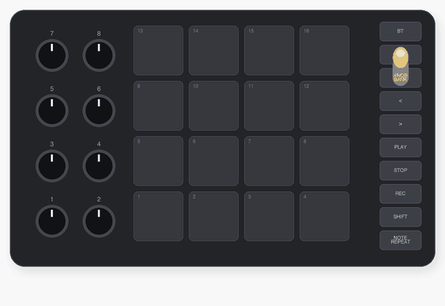

**SHIFT + KNOB BANK.** 16 patterns: green is playing, blue holds something, dark is empty.

- **Tap a pattern**: it takes over at the end of the current one (at once when stopped).
- **Hold one and tap others**: a chain, played in that order, looping.
- **SHIFT + a pad**: copy the current pattern there.
- **SHIFT + knob 3**: the pattern length (16, 32, 48, 64 steps) — when a queued pattern
  takes over. Tracks can be shorter or longer and loop on their own (polymeters).

Patterns live in the pad's flash and survive power-off and firmware updates.

 

## Tempo and sync

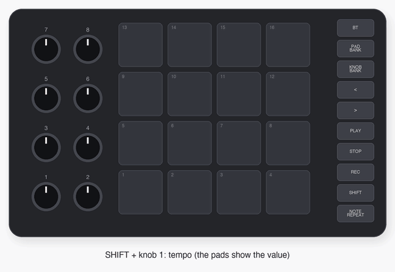

- **SHIFT + knob 1**: tempo (30–300 BPM); **SHIFT + knob 2**: swing of the pattern.
- Tap tempo: SHIFT + NOTE REPEAT, then tap pad 16.
- **The pad is the master** by default: it sends MIDI clock (also when stopped, so followers
  know the tempo) and start / stop with **PLAY** / **STOP**.
- **To follow another clock** (Ableton, a drum machine): SHIFT + NOTE REPEAT, **pad 15** (sync).
  It turns green while a clock comes in; the pad then starts, stops and keeps time with it.

 

## Ableton Live

The `ableton/SMC_PAD` control surface script makes the pad part of Live:

- the pads take **the colours of your Drum Rack**, and **empty Drum Rack pads stay dark**;
- with the pad following Live's clock, the pad's **PLAY / STOP start and stop Live**.

Setup:

1. `tools/install_ableton.sh` (copies the script to your User Library's *Remote Scripts*), then
   restart Live.
2. *Settings → Link, Tempo & MIDI → Control Surface*: **SMC_PAD**, input and output
   **SMC-PAD open fw**.
3. MIDI ports, **SMC-PAD open fw**:
   - **Live leads** (recommended: Live's clock is steadiest): output **Sync** on, input Sync
     off; on the pad, SHIFT + NOTE REPEAT → pad 15 (sync).
   - **The pad leads**: input **Sync** on, output Sync off; Live follows PLAY on the pad.
   - Input **Track** on, so the notes reach your tracks.
4. Select a track with a Drum Rack. The pads follow the selected (or armed) track's rack.

The tracks are matched by note: track 1 plays note 36 = the Drum Rack's first pad, and so on.

## Bluetooth

Hold **BT** for a second: Bluetooth on or off (the LED blinks while waiting, stays lit when
connected). The pad is then a BLE-MIDI device too — macOS (*Audio MIDI Setup → Bluetooth*), iOS
and Android apps (GarageBand, Koala, FL Studio …) connect to it; it sends the same notes, clock
and messages as over USB.

## Buttons

| button | | with SHIFT |
|---|---|---|
| **BT** | hold: Bluetooth on / off | |
| **PAD BANK** | STEP ↔ PLAY | MUTE mode |
| **KNOB BANK** | knob page A ↔ B | PATTERN mode |
| **<  >** | STEP: page · elsewhere: previous / next track | |
| **PLAY** | start / stop (Live's, when synced to it) | |
| **STOP** | stop (again: all notes off) | hold 1 s: kit back to notes 36–51, channel 10 |
| **REC** | live recording on / off | hold 1 s: clear the selected track |
| **SHIFT** | the second layer | |
| **NOTE REPEAT** | PLAY: note repeat · elsewhere: fill | note repeat settings |

**< and >** blinking together: low battery.

## Knobs

| knob | page A (KNOB BANK off) | page B (KNOB BANK on) | with SHIFT |
|---|---|---|---|
| 1 | track velocity (new steps) | CC 70 → lock 1 | tempo |
| 2 | gate (note length) | CC 71 → lock 2 | pattern swing |
| 3 | track length (1–64) | CC 72 → lock 3 | pattern length |
| 4 | track speed (½×, 1×, 2×) | CC 73 → lock 4 | track note |
| 5 | — | CC 74 | track MIDI channel |
| 6 | — | CC 75 | |
| 7 | euclidean hits | CC 76 | |
| 8 | euclidean rotation | CC 77 | |

Page B sends on the selected track's channel; knobs 1–4 there are the track's lockable CCs, and
their position is the value locked steps return to. With steps held in STEP mode the knobs edit
the steps instead ([STEP mode](#step-mode)).

## MIDI implementation

| | |
|---|---|
| notes | one per track (default 36–51), channel per track (default 10); note on/off with velocity, gate length |
| aftertouch | polyphonic, from pad pressure (PLAY mode) |
| CC | 70–77 from knob page B; 70–73 also from parameter locks |
| clock | out: 24 PPQN, always (as master); in: followed when sync is on |
| transport | out: Start / Stop; in: Start, Continue, Stop (when synced) |
| SysEx | `F0 7D 53 50 …` — the Ableton script's Drum Rack picture, hello and transport ([protocol](ableton/SMC_PAD/SMC_PAD.py)) |

Over USB and BLE-MIDI at once. (The 3.5 mm MIDI OUT is not driven yet.)

## Building and hacking

- `GrooveBox/` is a plain Arduino sketch: `arduino-cli compile --fqbn smcpad:br25:smcpad GrooveBox`.
  `Model.h` the data, `Engine.h` the sequencer (96 PPQN clock, event queue), `Store.h` the
  pattern storage, `GrooveBox.ino` the interface.
- The emulator runs it on your computer: with [open-smc-pad](https://github.com/fedepaj/open-smc-pad) cloned
  next to this repository, `../open-smc-pad/arduino/sim/build.sh GrooveBox` (see its README);
  `tools/make_images.py` rebuilds every picture of this page from the firmware.
- Why it is built this way — modes, storage, timing — is in [docs/design.md](docs/design.md).

## License

MIT — see [LICENSE](LICENSE). Not affiliated with M-Vave.
